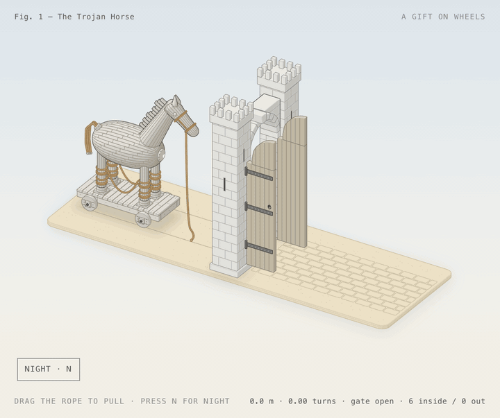
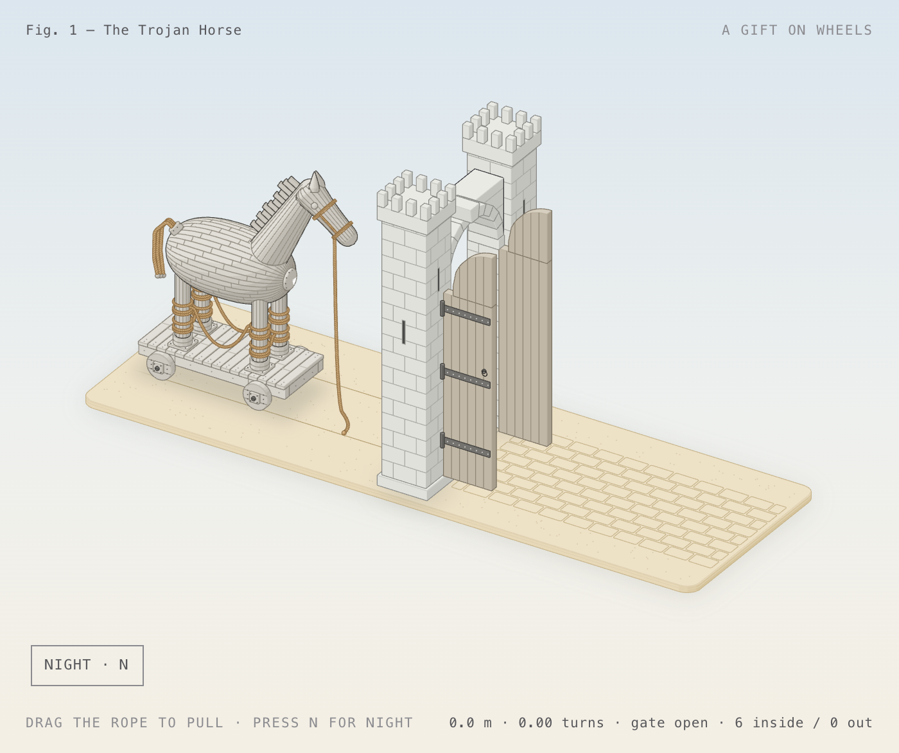
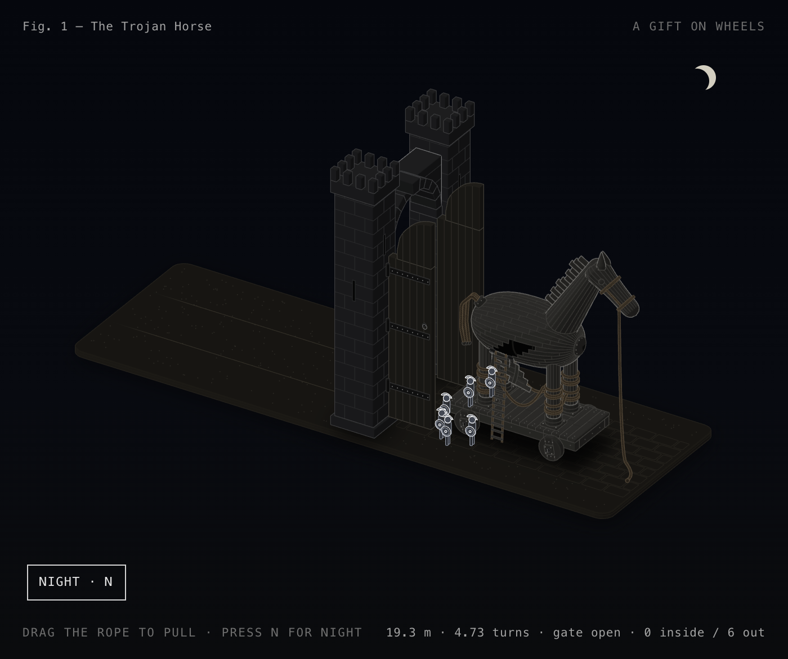
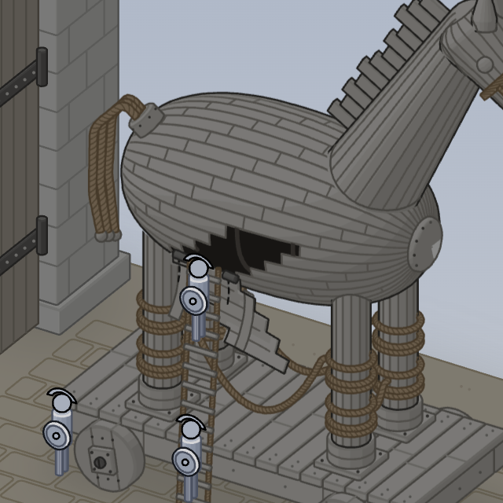
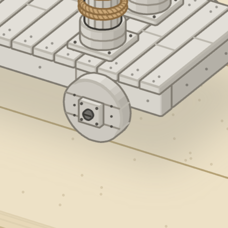

<div align="center">

# The Trojan Horse

**An interactive isometric figure of the oldest trick in the book, drawn by someone from the town that still keeps the horse.**



<sub>Fig. 1. Pull the gift in, wait for night, and watch it open the city from the inside.</sub>

</div>

---

## Selam from Çanakkale

I'm from Çanakkale. If you grew up here, the Trojan Horse isn't a myth from a textbook. It's part of the scenery.

Troy itself (*Truva*, the mound at Hisarlık) is about 30 km south of the city, on the plain above the Dardanelles. It has been a UNESCO World Heritage Site since 1998, and the Troy Museum opened next to it in 2018. A wooden horse stands at the entrance to the ruins, and kids climb up inside it. A second horse, the one built for the 2004 film *Troy*, was given to the city and stands on the seafront. People meet under it and take photos with it.

So when I wanted to build a technical drawing that explains *how something works*, this was the obvious subject. The trick worked because the outside of the horse said one thing and the inside did another. This figure lets you see both sides.

## What you can do

| Action | How | What happens |
|---|---|---|
| **Pull** | Drag sideways on the figure, or press <kbd>←</kbd> <kbd>→</kbd> | The cart rolls toward the city. The lead rope goes taut and the wheels turn without slipping. |
| **Pass the gate** | Keep pulling | Once the cart clears the swing of the doors, the two timber leaves close behind it. They won't let it roll back out. |
| **Night** | Press <kbd>N</kbd> or the **Night** button | The scene dims and the moon rises. A hatch hidden among the planks swings down on its hinges, a rope ladder unrolls, and six soldiers climb down one by one and run to open the gate. |
| **Do nothing** | Wait 7 seconds | The figure plays the whole story by itself, then rewinds it and plays it again. |

The hatch only opens once the horse is inside and the gate has shut. A trick that opens on the beach isn't much of a trick.

## How the trick works


## Day and night

<table>
  <tr>
    <td width="50%"></td>
    <td width="50%"></td>
  </tr>
  <tr>
    <td align="center"><sub>Day, light theme. The gift waits outside the walls.</sub></td>
    <td align="center"><sub>Night, dark theme. The gate is open again, from the inside.</sub></td>
  </tr>
</table>

## Up close

<table>
  <tr>
    <td width="58%"></td>
    <td width="42%"></td>
  </tr>
  <tr>
    <td align="center"><sub>The hatch is a five-board staircase cut along the plank joints, so it disappears into the pattern until it opens.</sub></td>
    <td align="center"><sub>Solid plank wheels with a square hub, nail heads and a linchpin.</sub></td>
  </tr>
</table>

Everything is built from small solid parts: individual planks laid in a diagonal brick pattern, a mane of short upright boards, two or three bands of rope lashing on every leg, ropes sagging between the legs, a breast boss, a knotted rope tail, merlons and arrow slits on the towers, and iron straps and studs on the doors. In total there are 339 parts in the horse and 33 in the gate.

## The numbers are real

The readout at the bottom of the card comes from the same model that moves the parts, so it can't drift away from the picture.

| Readout | Meaning |
|---|---|
| `19.3 m` | Distance the cart has rolled |
| `4.73 turns` | Wheel turns. The wheels have a 0.65 m radius, so one turn is 2π × 0.65 ≈ 4.08 m. 19.3 m ÷ 4.08 m ≈ 4.73. |
| `gate closed` | Gate state: `open`, `closing`, `closed` or `opening` |
| `3 inside / 3 out` | Soldiers still in the horse, and soldiers on the ground |

## Run it

`trojan-horse.html` is a single standalone file with no dependencies. Open it in any browser.

- `trojan-horse.html` follows your system's light or dark setting.
- `trojan-horse-light.html` is always light.

> [!TIP]
> If your system has **Reduce motion** turned on, the figure respects it. It jumps between states and the idle tour stays off. Turn the setting off to see the eased motion.

### Rebuild from source

The figure is generated by `build.mjs` using the [anatomy](https://github.com/wheresryan22/anatomy) isometric kit, which it loads from `~/.claude/skills/anatomy`.

```bash
npx skills add wheresryan22/anatomy -g -a claude-code   # once, installs the kit

node build.mjs           # writes trojan-horse.html
node build.mjs --light   # writes trojan-horse-light.html
node build.mjs --audit   # runs the geometry audit
```

The audit checks that no part passes through another, that every rope and seam ends on something real, and that every overlap is drawn in the right depth order.

## Files

```
Odysseus/
├── trojan-horse.html          the figure (follows system theme)
├── trojan-horse-light.html    the figure (always light)
├── build.mjs                  geometry: horse, cart, gate, soldiers
├── live.js                    motion: pulling, gate, night, tour, readout
├── trojan.css                 materials for both themes
├── media/                     the GIF, MP4 and stills used in this README
└── shots/                     test captures and close-ups from development
```

<div align="center">
<sub>Çanakkale'den sevgilerle 🐴</sub>
</div>
